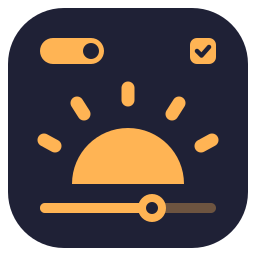

<p align="center">
  
</p>

<h1 align="center">lys-ui</h1>

<p align="center">
  A pure-Go (no cgo) widget toolkit for Wayland, built as a
  feature-complete counterpart of <a href="https://relm4.org">relm4</a>: a component
  framework with typed messages, a retained widget tree with
  GTK4/libadwaita-class widgets and a modern component set,
  xdg-shell and layer-shell windows, a GTK-flavored CSS engine over a
  typed palette, the desktop's portals and protocols, and an event loop
  that idles at 0% CPU.
</p>

<p align="center">
  <a href="https://github.com/stubbedev/lys-ui/actions/workflows/ci.yml"></a>
  <a href="LICENSE"></a>
  <a href="https://stubbedev.github.io/lys-ui/"></a>
</p>

<p align="center">
  
</p>

## Install

```sh
go get github.com/stubbedev/lys-ui@latest
```

## A minimal app

```go
package main

import (
	"log"
	"strconv"

	"github.com/stubbedev/lys-ui/app"
	"github.com/stubbedev/lys-ui/component"
	"github.com/stubbedev/lys-ui/ui"
	"github.com/stubbedev/lys-ui/widget"
)

type Msg int

const (
	Increment Msg = iota
	Decrement
)

type Counter struct {
	env ui.Env
	n   int
}

func (c *Counter) Init(cx *component.Context[Msg, int]) widget.Widget {
	return ui.Mount(cx, c.env, ui.Row(
		ui.Button(ui.Label("-"), 8, 6).OnClick(func() { cx.Input(Decrement) }),
		ui.Expand(ui.Label("").WatchText(func() string { return strconv.Itoa(c.n) })),
		ui.Button(ui.Label("+"), 8, 6).OnClick(func() { cx.Input(Increment) }),
	).Spacing(6))
}

func (c *Counter) Update(cx *component.Context[Msg, int], msg Msg) {
	switch msg {
	case Increment:
		c.n++
	case Decrement:
		c.n--
	}
	cx.Output(c.n)
}

func main() {
	err := component.Run(app.WindowConfig{Title: "counter", AppID: "dev.example.counter"},
		func(a *app.Application) (*Counter, error) {
			face, err := app.Font("sans-serif", 15)
			if err != nil {
				return nil, err
			}
			if err := a.AddAccel("Escape", widget.NewAction("quit", a.Quit)); err != nil {
				return nil, err
			}
			return &Counter{env: ui.Env{Face: face, Size: 15}}, nil
		})
	if err != nil {
		log.Fatal(err)
	}
}
```

This program is kept compiling as `ExampleRun` in
`component/example_test.go`.

## Documentation

The [documentation site](https://stubbedev.github.io/lys-ui/) has the
[getting started guide](https://stubbedev.github.io/lys-ui/guide/getting-started),
a screenshot of [every widget](https://stubbedev.github.io/lys-ui/widgets)
taken from the current code on every push, the
[demos](https://stubbedev.github.io/lys-ui/guide/demos), the
[development workflow](https://stubbedev.github.io/lys-ui/guide/development)
and the reference.

## The lys family

lys-ui is the widget toolkit of the lys desktop:
[lys-shell](https://stubbedev.github.io/lys-shell/) (desktop shell),
[lys-wm](https://stubbedev.github.io/lys-wm/) (compositor),
[lys-lib](https://stubbedev.github.io/lys-lib/) (building blocks),
[lys-login](https://stubbedev.github.io/lys-login/) (display manager and lock screen),
[lys-splash](https://stubbedev.github.io/lys-splash/) (boot splash),
[lys-polkit](https://stubbedev.github.io/lys-polkit/) (polkit agent) and
[lys-secrets](https://stubbedev.github.io/lys-secrets/) (Secret Service).

## License

MIT
